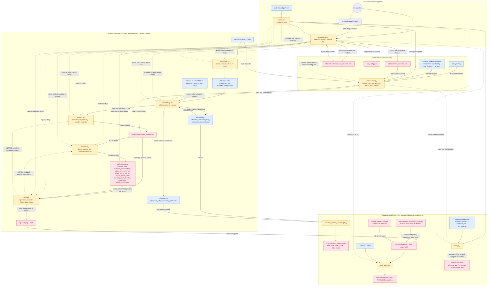
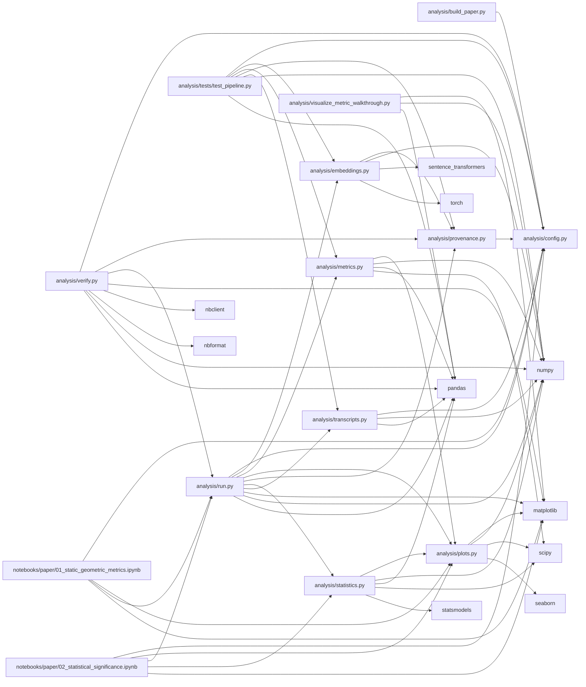

# Repository dependency diagrams

Replacement Mermaid sources for the supplied GitDiagram image, checked against the current checkout.

- [Data flow and orchestration](gitdiagram.mmd): pipeline stages, cached artifacts, validation, configuration, manuscript and verification workflows.
- [Direct code dependencies](gitdiagram-imports.mmd): every static internal and third-party import in the active `analysis/*.py` modules, regression test, and two paper notebooks, including imports inside functions. Standard-library imports are omitted. Arrows point from importer to dependency.

These views cover the active paper workflow. Historical `analysis/legacy`, exploratory/frozen notebook internals, and transitive package dependencies are not expanded; `uv.lock` remains the full environment dependency record. This is a local replacement, not an edit to the hosted GitDiagram page.

## Data flow and orchestration

Solid arrows show data, artifact, or entry-point relationships; dashed arrows show calls, settings, and helper dependencies. Labels specify direction. File reads/writes for metrics, statistics, and figures happen in `run.py`; those modules mostly receive in-memory objects.

`metrics` always goes through the embeddings stage (which may reuse a validated cache). Standalone statistics and figures read saved metrics. Figures can render metric trajectories without statistics; effect/diagnostic figures require statistical outputs and a valid analysis manifest. Recorded code/package hashes do not imply every hash is checked on every reuse.

The walkthrough generator reads the cached matrix and indexed utterances. The manuscript's curated walkthrough images are preserved separately and are not regenerated by its default invocation. Manuscript tables/prose are not automatically synchronized with statistical CSVs.

## Direct code dependencies

Generated by inspecting Python AST import nodes, including function-local imports. External packages are grouped by top-level import name. This captures static imports, not every runtime call or dynamically loaded package.

